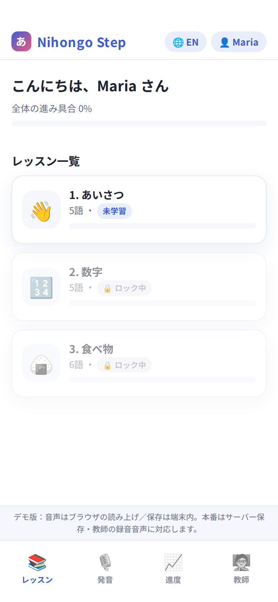

# Nihongo Step デモ（外国人向け日本語学習Webアプリ）

教師が作った教材を流し込むだけで学べる「器」のデモです。スマホアプリ型の画面で、PCで開いてもスマホの枠で表示されます。

**デモURL**: https://ai-flow-architect.github.io/nihongo-learning-demo/

## 触れる機能

| 機能 | 内容 |
|---|---|
| 学習者アカウント | 名前で簡易ログイン（デモはブラウザ内に保存） |
| レッスン進行 | 前のレッスンを終えると次が開く |
| 音声 → 絵を選ぶ | 音声を聞いて正しい絵を選ぶ |
| 発音の録音 | 自分の声を録音・再生し、お手本と聞き比べ（録音は端末内のみ） |
| フラッシュカード／選択式クイズ／絵と文字のマッチング | 教材から問題を自動で作成 |
| 進度の保存 | 途中でやめても、次回ログイン時に続きから |
| 教材の管理（教師用） | 単語の追加・編集・お手本音声の録音・レッスン追加・JSONの書き出し／読み込み |
| 表示言語 | 日本語／英語 |

## デモの前提

- サーバー不要の静的Webアプリです。データは閲覧中のブラウザにだけ保存されます
- 音声はブラウザの読み上げ機能を使っています（教師が録音した音声に差し替え可能）
- 教材はすべて見本です
